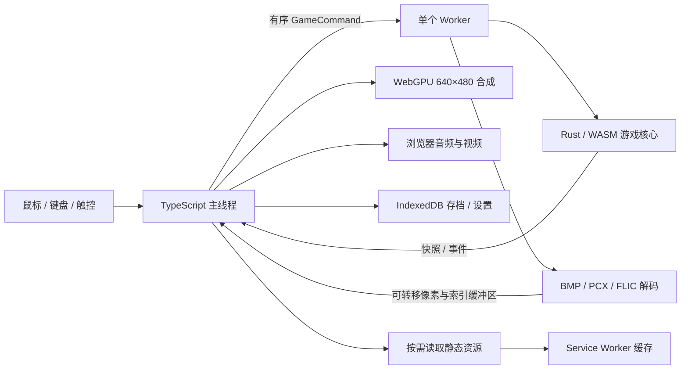

# 运行架构

页面由 GitHub Pages 提供，运行时没有业务服务器、账号或远程存档接口。

## 状态和时间

`crates/virtual-life-core/src/engine.rs` 接受严格递增的命令序号，运行 N1 事件解释器及各个原生玩法模块，输出可序列化快照和事件。不可识别的状态或操作会返回错误；缺少还原依据的流程保留当前状态并给出原因，不随机替代原始规则。

原版 CRT 随机流在 Rust 中保存，采用相同的 32 位回绕与 15 位结果。抽卡、地图装饰、奖励数字动画和房产预览转场等原版会消耗随机数的显示过程也留在核心。住宅雨帘支持中途保存；马赛克转场按原版同步完成。参数预览不改变人物属性，但会推进共享随机流。部分原生小游戏按帧更新，部分动画按毫秒判断且每帧最多推进一次；两者不能合并成统一的按秒物理模拟。浏览器传入明确的帧时间命令，暂停时停止推进。

N1 程序的有符号节点 ID、首个重复 ID 优先、随机跳转、任务条件与结果数值均保留原始语义。职业、商店、神灵、小游戏、战斗、结局等原生入口会挂起解释器，待对应活动完成后按原顺序返回。

## 画面和资源

`src/engine.worker.ts` 拥有一个 WASM 引擎及动画解码器。主线程通过 `EngineClient` 交换消息，不使用 SharedArrayBuffer。位图像素和调色板索引通过可转移缓冲区返回，支持按原版索引透明及局部调色板变化。游戏画面使用 WebGPU，网页覆盖层承担文字输入、可访问按钮和移动端触控。

资源由原始路径映射到 SHA-256 内容地址。安装文件与光盘散文件保留独立命名空间，并按原加载路径选择。原视频另有可播放的无损转码副本，来源及转换参数记录在清单中。客户端每次下载资源都核对 SHA-256。

动画逐帧解码，不把全光盘展开为 RGBA 图集。显示资源使用有界缓存，退出活动后释放或复用。显示设备丢失时暂停游戏并保存进度，提示用户刷新页面以重建 WebGPU 资源并继续游戏；当前不支持同页重建。输入和音频在后台暂停。

## 存储和更新

IndexedDB 数据库 `virtual-life` 的 `saves` 表保存 `current` 与 `previous`，`settings` 保存选项。存档外层记录内容版本、保存时间和 SHA-256；内层还包含格式版本、完整核心状态、待执行事件、活动阶段与随机数状态。内容标识在 Rust 中对解析后的规范 JSON 计算，统一对象键顺序、安全整数的 `1.0` / `1` 表示及负零，并启用精确浮点解析；同一目录经过浏览器 JSON 往返不会让存档失效，实际数据变化仍会改变版本标识。

保存先在事务外计算校验值，再在写事务中核对当前版本并原子更新两个槽位。损坏的当前记录不会替换有效备份；写失败回滚整个事务。单个连接按调用顺序排队，多连接冲突时重新读取并有限重试。格式版本 1 是首个网页存档格式，未知格式或不同内容版本会被明确拒绝；没有伪装成网页存档的原版导入。

Service Worker 的应用壳缓存名包含构建 ID；素材缓存使用不可变内容地址并跨构建复用。它仅缓存成功读取的文件。旧页面关闭前不会强制 `skipWaiting`，因此同一运行会话不会被新引擎替换。浏览器缓存写入失败不阻止联网读取，也不会删除 IndexedDB 存档。

## 构建与发布边界

`tools/build-wasm.mjs` 构建固定 Rust 工具链并生成前端绑定，Vite 统一使用 `/VirtualLife/` 基础路径。构建插件复制实际素材和目录，生成应用壳清单及 Service Worker 构建 ID。

`tools/verify-assets.mjs` 检查全部对象的 SHA-256、长度、清单引用、路径和统计数。发布检查额外遍历全部产物，拒绝 LFS 指针、研究文件、缺失 WASM 和超出 1 GB 的站点。GitHub Actions 在这些检查和浏览器测试成功后上传官方 Pages artifact，再部署到 `github-pages` 环境。
