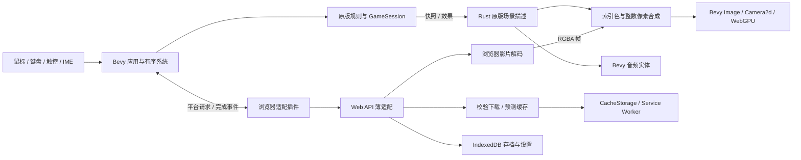

# 运行架构

客户端是单个完整 Bevy 应用，编译为 WASM 后由 GitHub Pages 分发。运行时没有业务服务器、账号或远程存档接口。所有可见游戏内容和交互由 Rust 应用管理。

## 包和职责

- `virtual-life-core` 保留原版整数、随机数、事件解释器和各玩法算法，提供 `GameSession`、`GameCommand`、`GameSnapshot` 与效果类型。该包不依赖 Bevy，原始机器码样本和本地流程探针可独立验证规则。
- `virtual-life-app` 拥有 Bevy 应用、输入状态、场景生命周期、原版表现、图像合成、音频实体和预取规划。网页构建启用 `web-client`，原生测试使用无窗口应用。
- `virtual-life-web` 执行浏览器平台请求，启动 Bevy WASM，并通过 `web/platform.js` 适配文件选择、IME、IndexedDB、CacheStorage、页面状态和影片解码。JavaScript 适配层不维护第二份玩法状态，也不绘制游戏画面。

旧 TypeScript 游戏视图、手写 WebGPU 运行时、游戏 Worker 及其消息协议已经移除。静态网页仅负责装载、画布尺寸和启动失败提示；隐藏的 IME 与可访问描述由 Bevy 状态驱动。

## 状态、输入和时间

有序 Bevy 系统先接收浏览器事件和物理输入，再处理命令、推进当前活动、生成场景及更新图像和音频。`GameSession::send` 分配连续命令序号；需要严格验证外部序号时使用 `dispatch`。核心模块直接调用 Rust 接口，浏览器边界通过请求与完成队列传递平台结果。

原版 CRT 随机流采用 32 位回绕和 15 位结果。地图初始化、奖励计数、抽卡、关系屋悬停和房产转场等消耗共享随机数的行为保留在核心。不可识别的操作返回错误；已知未定义原始数据保留进度并提示，不随机补造规则。

原构造函数已准备、但尚未显示的资源列入 `SceneFrame.required_resources`，加载完成后才接受输入。建角会提前准备两个按钮 WAV、隐藏的男女与确认/取消动画、星座和血型图；轮回与系统菜单也会提前准备离屏光标，避免首次悬停触发下载暂停而丢失同一次点击的松开事件。

玩法帧与显示时钟分开：部分原生玩法每个可见帧只更新一次，部分动画在超过毫秒阈值后最多推进一次。异形追踪的动画另保留原有有限追帧规则。不能用统一固定物理步长或后台时间追赶替代这些语义。

表现层保存各动画的帧、首次更新标志、循环和等待状态。骰子逐显示帧播放；人物转向为十帧，移动为每格二十四次累计整数位移。运动完成前禁止新的玩法命令，之后显示核心已产生的后续场景。按住键、鼠标和多点触控由同一输入状态聚合；失焦、隐藏和切换场景释放捕获并暂停推进。

## 画面、文字和媒体

逻辑画布为 640×480，使用最近邻缩放并保持 4:3。原版场景描述包含图像、帧、源区域、裁剪、图层、文字、热区、声音与影片时间。Rust 在字节空间按原索引色规则合成像素，再交给 Bevy 的 Image 和二维相机通过 WebGPU 呈现，避免默认颜色空间运算改变原版整数颜色结果。

原位图和 FLIC 动画保留调色板索引，分别处理不透明、固定索引透明与首像素索引透明。局部调色变化、调色循环、GDI 索引映射、雨帘、震动和原图层排序均由表现层与合成器明确执行。动画逐帧解码，退出场景释放或复用解码状态，不将整张光盘展开为 RGBA 图集。

使用原版 ASCII 8×16 和 GB2312 16×16 位图字库的界面继续使用原字库。经用户允许，原 GDI 文字统一改用文泉驿点阵宋体：共享字符索引和宽度类别，按固定单元保存 12/13/16 像素的 1bpp 字形；其他字号最近邻采样，粗体统一水平扩张。浏览器不依赖系统字体，不逐字调整字体，原逻辑字距、行高与控件热区保持原布局。替代字形是明确的保真例外，不作为 Windows 9x 原版文字像素证明。

`render.rs` 将视觉投影与控件、音效和领域时钟分开。Bevy `Local` 只缓存实际绘制字段及资源版本，稳定帧无需生成 JSON 签名或修改 `PixelCanvas`，图像资产沿用变更检测上传。影片在解码帧到达或字幕等视觉内容改变时重绘，时钟与流程仍按原顺序更新。合成器复用图层缓冲、提前裁剪并预计算索引色运算；完整像素对照与基准见 [性能优化记录](performance-2026-10-30.md)。

WAV 由 Bevy 音频实体管理播放、停止、循环、位置和主音量。浏览器首次真实手势负责解锁其音频上下文。影片保留已逐帧验证的无损 WebM 衍生文件，浏览器仅负责解码指定帧；帧选择、字幕、扫描线、位置和后续流程仍由 Rust 控制，解码帧送回 Bevy 合成。

影片切换和退出时关闭旧解码器并更换代次，迟到的旧帧不能覆盖新片段，也不能清除新请求。失败与胜利结局分别使用原 `aopen03` 和 `aopen04`，按各自已核实的帧数结束。

## 资源和持久化

原始路径通过 manifest 映射到 SHA-256 对象，安装目录与光盘散文件使用独立命名空间。浏览器适配层核对长度和 SHA-256 后才持久缓存；损坏缓存删除并绕过旧 HTTP 缓存重新请求。按 hash 合并下载，压缩字节内存缓存限制为 32 MiB。

Rust 预取规划根据当前场景、角色和临近人生阶段生成有序资源计划，并在语义边界缓存规划结果。后台最多并发两个压缩文件下载，不预先解码；前台请求优先。新场景替换尚未开始的计划，隐藏、离线、省流量和慢网络暂停后台启动。

新 IndexedDB 数据库 `virtual-life-bevy` 保存 `current`、`previous` 和设置。新导出格式为 `virtual-life-bevy-save`，不读取或迁移旧网页数据库，也不接受 Windows 存档。完整格式与原子写入约束见 [存档说明](storage.md)。

Service Worker 按构建 ID 缓存应用壳，原素材内容缓存 `virtual-life-disc-v1` 跨构建复用。旧页面关闭前不会强制接管，避免同一会话混用引擎和目录。缓存配额失败仍允许联网读取，不清除存档。显示设备丢失时保存当前进度并暂停，刷新后重新建立显示设备。

## 构建与验证边界

`tools/build-wasm.mjs` 构建 `virtual-life-web`，从 Cargo lockfile 读取 `wasm-bindgen` 版本并核对 CLI，再生成 `web/wasm/` 绑定。Vite 使用 `/VirtualLife/` 基础路径，复制实际素材并生成应用壳清单和 Service Worker 构建 ID。

测试输入接口由独立 `test-api` 特性和 localhost 检查共同限制，测试产物写到 `output/test-site/`；生产构建写到 `dist/`。资源完整性、规则样本、平台事务、输入、原素材像素和实际浏览器流程分别验收，详见 [验证说明](validation.md) 与 [保真边界](fidelity.md)。
